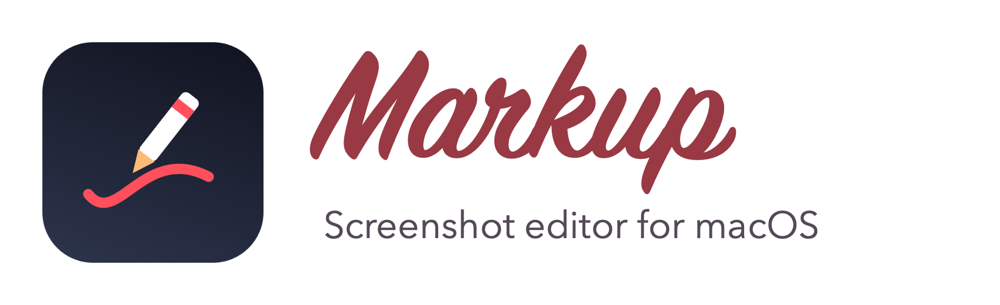

<picture>
  <source media="(prefers-color-scheme: dark)" srcset="Documentation/Artwork/header-dark.png">
  
</picture>

# Markup

Draw an arrow, click to type a caption, then press **⌘C** to copy the finished screenshot. Markup brings Telegram’s drawing tools to a standalone AppKit editor. It saves edits directly to your image and keeps an undo history you can return to later.

## Install

Requires **macOS 27 or later on Apple silicon**. Download the app ZIP from [GitHub Releases](https://github.com/nikstar/Markup/releases), unzip it, and move **Markup.app** to **Applications**.

## Mark up a screenshot

- **Start with a screenshot.** With Markup running, drag the macOS screenshot thumbnail onto the drop area above it. You can also drop an image on the menu-bar pencil, use Finder’s **Open With → Markup**, or press **⇧⌘N** to start from the clipboard.
- **Point something out.** Choose the arrow brush and draw in one stroke. For a bendable arrow, choose **Shapes → Arrow** and drag its center handle. The brush shelf also includes a pen, marker, neon, blur, and eraser.
- **Write directly on the image.** Press **T**, click, and type. Use **⌘Return** to finish. Pinch to zoom in on a detail or press **⌘0** to fit the screenshot again.
- **Keep editing the original.** Single-frame PNG, JPEG, and TIFF files autosave in place. Markup keeps up to 80 undo steps locally by default. Use **Save Editable Project Copy…** to take the layers to another Mac.

The [editing guide](Documentation/Editing.md) covers tools, shortcuts, redaction, and file formats. The [macOS integration guide](Documentation/Integrations.md) covers Quick Look, Services, the Action extension, and launch at login.

## Build from source

Open `Markup.xcodeproj` in Xcode with the macOS 27 SDK and run the **Markup** scheme. The repository includes its drawing engines, shaders, and artwork. To build and test from Terminal:

```sh
./Scripts/build.sh
./Scripts/test.sh
```

Local builds use ad-hoc signing. The [release guide](Documentation/Releasing.md) covers Developer ID signing, Apple notarization, and publishing a downloadable app.

## License and credits

Markup is licensed under the **GNU General Public License, version 2 or later**. The drawing engines, selection geometry, text layout, and brush artwork are adapted from Telegram for iOS. The toolbar blur incorporates work from VariableBlur. [License](LICENSE) · [Third-party notices](Resources/NOTICE.txt) · [Source and artwork credits](Documentation/Provenance.md)
